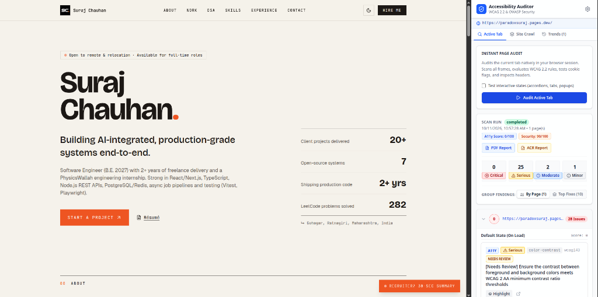
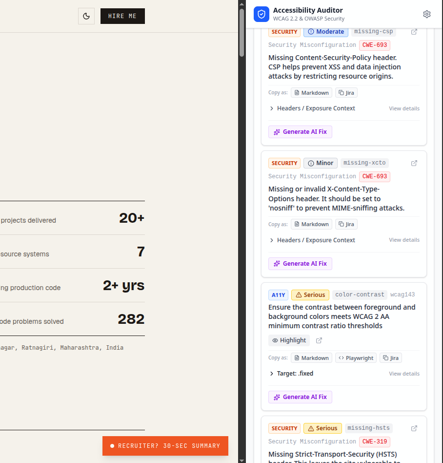
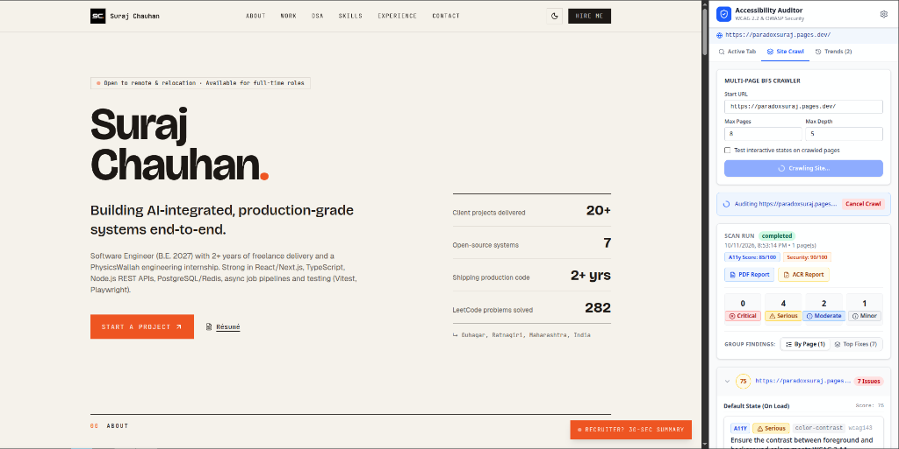
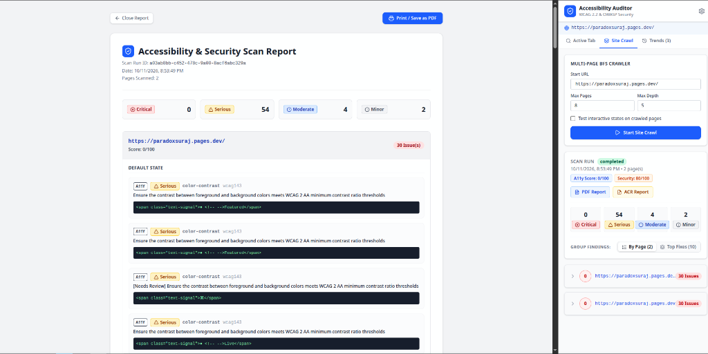

# Accessibility & Security Auditor (Chrome MV3)

A fast, local-first browser extension combining **WCAG 2.2 accessibility audits** (via `axe-core 4.10.2`), **passive web security analysis**, **interactive state testing**, and **multi-page crawling** into a single developer tool.

Includes optional, privacy-respecting **AI remediation (BYOK)** supporting Google Gemini, OpenAI, Anthropic Claude, DeepSeek, xAI Grok, and OpenRouter.

[](LICENSE)
[]()
[](https://github.com/dequelabs/axe-core)
[]()

---

## Preview

<p align="center">
  
</p>

### Screenshots & Features in Action

| Instant In-Page Audit | Issue Triage & AI Remediation |
| :---: | :---: |
|  |  |
| **Instant active-tab scan with decoupled A11y and Security scores** | **Triage cards with 1-click Markdown/Jira/Playwright copy & AI fixes** |

| Multi-Page Site Crawler | Full Scan & VPAT Report |
| :---: | :---: |
|  |  |
| **Same-origin BFS crawl with depth limits, robots.txt & live cancellation** | **Comprehensive audit summary & Section 508 VPAT matrix (PDF export)** |

---

## Features

- **Automated WCAG 2.2 Engine:** Powered by pinned `axe-core 4.10.2`, targeting Level A, AA, 2.1, and 2.2 criteria.
- **Root-Cause Clustering ("Top Fixes"):** Groups repetitive template issues across pages by CSS selector pattern, letting you fix one component to resolve dozens of violations.
- **In-Page Element Highlighter:** Outlines violating DOM elements on the live page using an isolated closed Shadow DOM container with zero host page style contamination.
- **Interactive Component Audits:** Discovers dynamic elements (accordions, dropdowns, `<details>`, menus) with `aria-expanded` and audits their opened states with clean DOM restoration.
- **Passive Web Security Analysis:**
  - Evaluates `Strict-Transport-Security`, `Content-Security-Policy`, `X-Content-Type-Options`, and frame clickjacking protections.
  - Audits cookie security flags (`Secure`, `HttpOnly`) with in-memory value redaction.
  - Optional opt-in check for exposed `.git` and `.env` files with soft-404 baseline detection.
- **Same-Origin Site Crawler:** Breadth-first crawl with customizable depth, page limit, delay, and `robots.txt` compliance.
- **Multi-Provider Cloud AI (BYOK):** Client-side code remediation using your own API key for Google Gemini, OpenAI, Claude, DeepSeek, Grok, or OpenRouter. Sensitive tokens, credentials, and script tags are redacted before sending.
- **VPAT & Conformance Reports:** Exports formal ITI VPAT 2.5 and OWASP Top 10 matrices with clean print-to-PDF formatting.
- **Local-First & Private:** All audit data stays on your machine in local IndexedDB. No remote servers, analytics, or third-party trackers.

---

## Honest Testing Coverage

> **Note for QA & Accessibility Teams:**  
> Automated testing tools (including axe-core) reliably evaluate approximately **30% to 40%** of WCAG 2.2 Level A/AA success criteria. Automated scans cannot evaluate reading order, semantic clarity, or screen-reader usability.
> 
> A score of **100/100** signifies zero automated violations detected under the active ruleset. Comprehensive compliance still requires manual testing with assistive technologies (NVDA, VoiceOver, JAWS) and keyboard-only navigation.

---

## Quick Start

### Prerequisites
- Node.js 18+ and npm
- A Chromium-based browser (Chrome, Brave, Edge)

### Installation from Source

1. Clone the repository:
   ```bash
   git clone https://github.com/paradox-suraj/Accessibility-Auditor-extension.git
   cd Accessibility-Auditor-extension
   ```

2. Install dependencies:
   ```bash
   npm install
   ```

3. Build the extension:
   ```bash
   npm run build
   ```
   The compiled extension will be in `.output/chrome-mv3`.

4. Load into your browser:
   - Navigate to `chrome://extensions` (or `brave://extensions` in Brave).
   - Toggle **Developer mode** in the top-right corner.
   - Click **Load unpacked** and select the `.output/chrome-mv3` directory.
   - Click the extension icon or open the Side Panel on any website to begin auditing.

---

## Development

```bash
# Start dev mode with live reload
npm run dev

# Run TypeScript typecheck
npm run compile

# Run Vitest test suite
npm run test

# Build production bundle
npm run build

# Package zip archive for distribution
npm run zip
```

---

## Project Structure

```text
├── assets/         # Global stylesheets (Tailwind CSS v4)
├── components/     # React UI components (Side Panel, Result Cards, Charts)
├── core/           # Core auditing engine
│   ├── __tests__/  # Vitest test suites (scoring, security, compliance)
│   ├── clustering.ts    # Component-level root cause clustering
│   ├── crawler.ts       # Same-origin BFS crawler
│   ├── db.ts            # IndexedDB schema & Dexie migrations
│   ├── inPageHighlighter.ts # Shadow DOM element overlay
│   ├── interactive.ts   # Expandable state testing & restoration
│   ├── remediate.ts     # Multi-provider AI remediation engine
│   ├── scoring.ts       # Deterministic scoring algorithm
│   └── securityScanner.ts # Passive headers & cookie analyzer
├── docs/           # Technical documentation & media
│   ├── screenshots/     # Extension preview images
│   ├── DECISIONS.md     # Architecture Decision Records (ADRs)
│   ├── PERMISSIONS.md   # Least-privilege permissions justification
│   ├── PRIVACY.md       # Privacy policy
│   ├── ROADMAP.md       # Feature roadmap & milestones
│   └── SCORING.md       # Scoring formula & confidence tiers
├── entrypoints/    # WXT entrypoints (sidepanel, options, report, acr)
└── public/icons/   # Extension icons (16, 32, 48, 128 px)
```

---

## Documentation

For technical details, see the [`docs/`](docs/) directory:
- [Architecture Decisions (ADRs)](docs/DECISIONS.md)
- [Scoring & Confidence Methodology](docs/SCORING.md)
- [Permissions Justification](docs/PERMISSIONS.md)
- [Privacy Policy](docs/PRIVACY.md)
- [Project Roadmap](docs/ROADMAP.md)

---

## License

This project is licensed under the [MIT License](LICENSE).
